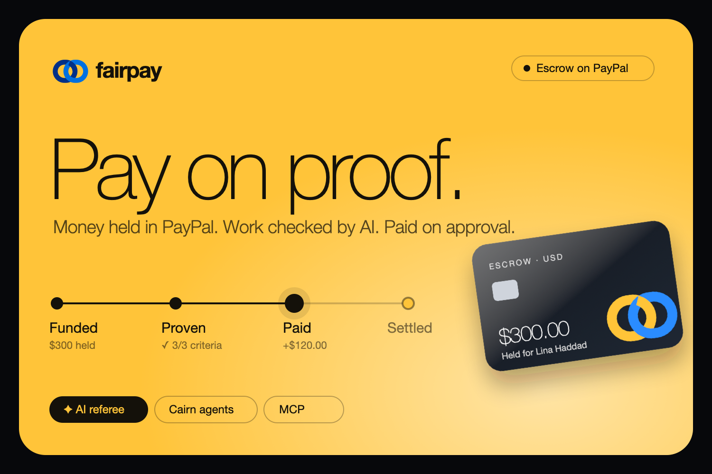
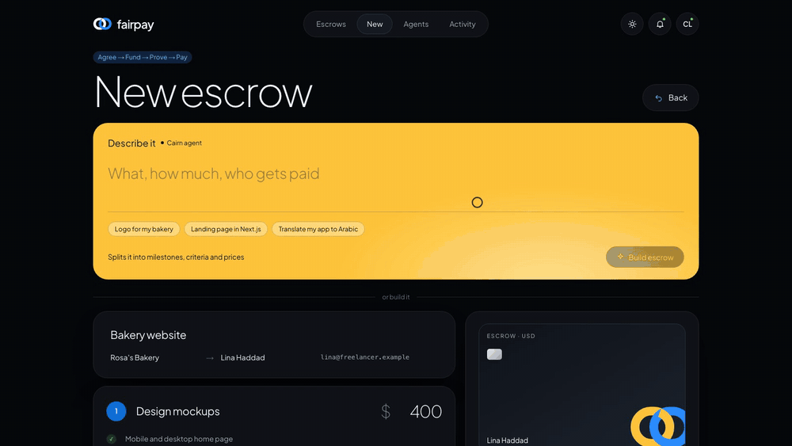
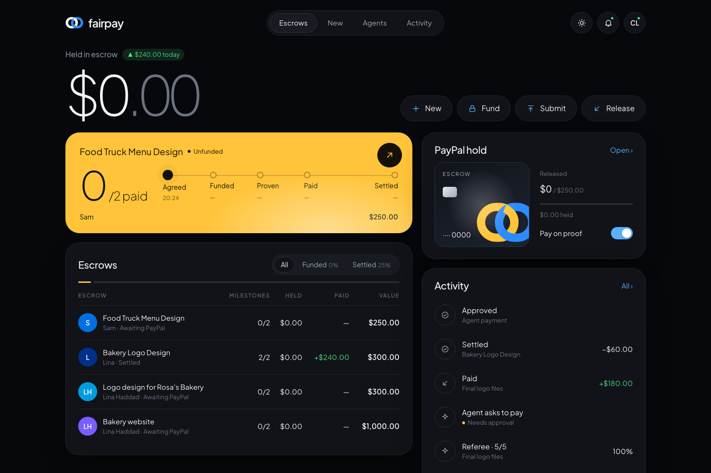
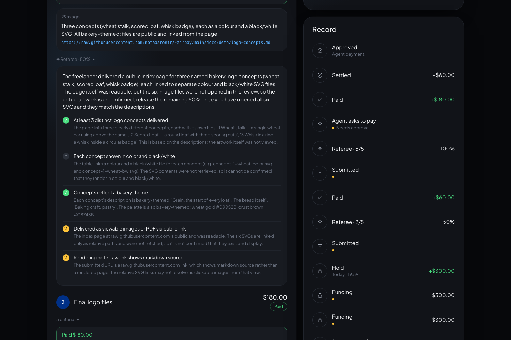
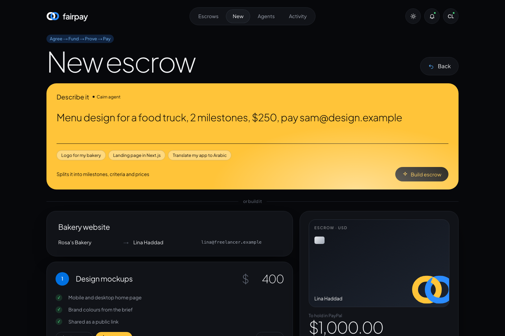
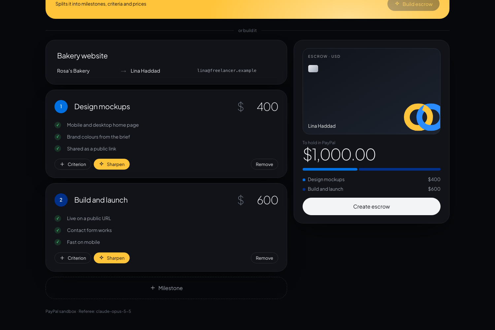
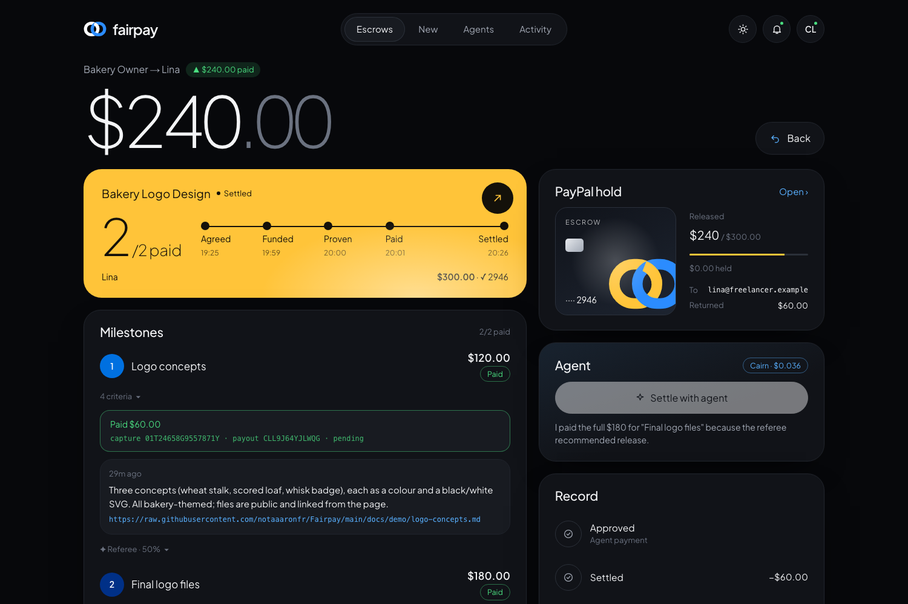
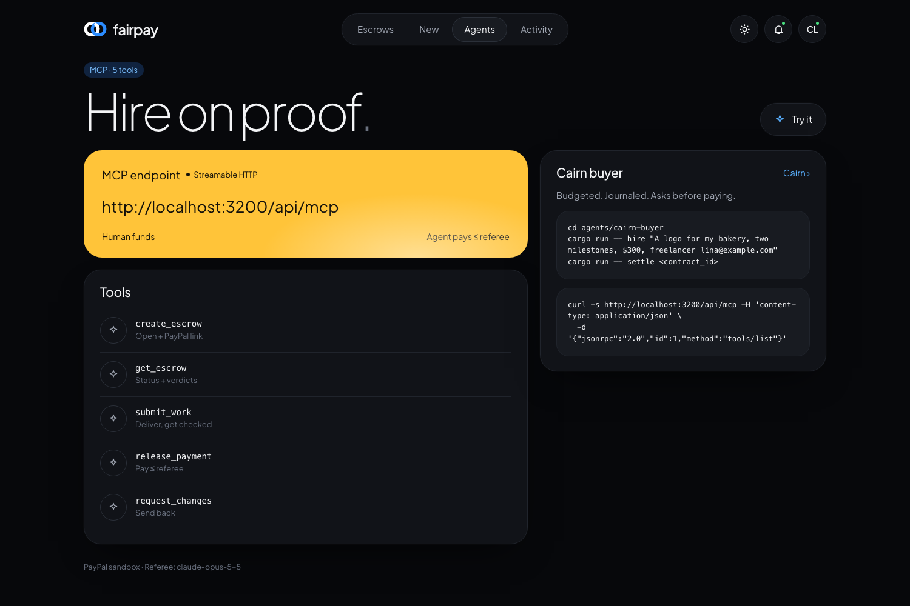
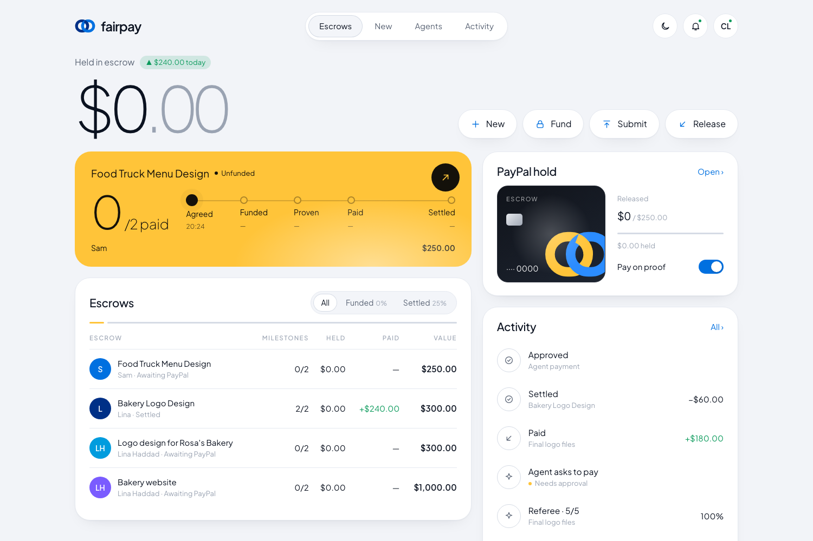
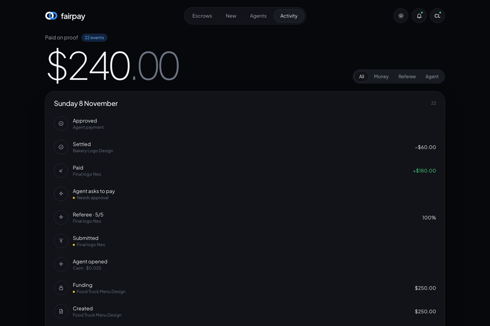

<div align="center">



# Fairpay

**Get paid for the work you did. Pay only for the work you got.**

Milestone escrow on PayPal with an AI referee — and agents that can hire, but only pay on proof.

[**Live demo**](http://187.126.26.84:8790) · [**Demo**](#demo) · [How it works](#how-it-works) · [Run it](#run-it) · [For agents](#for-agents)


-b7410e?logo=rust)


</div>

---

## Demo

<div align="center">


<sub>Real run on the PayPal sandbox: the agent opens an escrow from one sentence → the referee checks the delivery criterion by criterion → the agent asks to pay, a person approves, and PayPal captures and pays out.</sub>
</div>

## Why

Paying a stranger for work is a trust problem on both sides. Freelancers start without knowing they'll be paid; clients pay without knowing they'll get the work; and "done" was never written down in a way anyone can check. AI agents are now starting to buy services for people — nobody wants one that can send money with no proof and no limit.

## How it works

| | Step | What happens | PayPal |
|---|---|---|---|
| 1 | **Agree** | Milestones, each with a price and acceptance criteria. AI turns "make it look good" into checks anyone can verify. | — |
| 2 | **Fund** | The client approves the total in PayPal. It's **held, not taken** — the freelancer can see the money exists. | Orders v2 · `intent: AUTHORIZE` |
| 3 | **Prove** | The freelancer submits a link. The **AI referee** reads it and marks every criterion *met / partial / missing / can't verify*, with evidence, then recommends what to release. | — |
| 4 | **Pay** | One click releases exactly that amount — captured from the hold and **paid out**. | Capture (`final_capture: false`) + **Payouts** |
| 5 | **Settle** | Whatever was never earned is voided back to the client. | Authorization void |

> The referee recommends; it never pays. Money moves only on a person's click — and agents can never release more than the referee recommended.

<details>
<summary><b>What a real verdict looks like</b></summary>

On a logo-concepts delivery, the referee confirmed three bakery-themed concepts but noticed it couldn't open the six image files — so instead of guessing it recommended **50%**, and told the freelancer exactly how to earn the rest. $60 was captured and paid out; $240 stayed held. On the final files it found every criterion met and recommended **100%**. The sandbox trail is in [`docs/sandbox-evidence.md`](docs/sandbox-evidence.md).

</details>

## Screenshots

<table>
<tr>
<td width="50%"><br/><sub><b>Dashboard</b> — what's held, a live tracker per escrow, recent activity</sub></td>
<td width="50%"><br/><sub><b>AI referee</b> — every criterion, its evidence, and the release it recommends</sub></td>
</tr>
<tr>
<td><br/><sub><b>Describe it</b> — one sentence, and the agent opens the escrow</sub></td>
<td><br/><sub><b>Builder</b> — milestones, criteria, live split and total</sub></td>
</tr>
<tr>
<td><br/><sub><b>Escrow</b> — held, paid, returned; agent and record</sub></td>
<td><br/><sub><b>For agents</b> — MCP endpoint, tools and guardrails</sub></td>
</tr>
<tr>
<td><br/><sub><b>Light mode</b> (default)</sub></td>
<td><br/><sub><b>Activity</b> — every hold, verdict and payout, filterable</sub></td>
</tr>
</table>

## Run it

Requires Node 22.13+ (uses the built-in `node:sqlite`).

```bash
git clone https://github.com/notaaaronfr/Fairpay && cd Fairpay
npm install
npm run dev            # http://localhost:3000
```

**No keys needed.** Without PayPal credentials PayPal runs *simulated* (ids start with `SIM-`, nothing moves); without an AI key an *offline referee* matches evidence by keyword. The footer always says which mode you're in.

For the real thing, create `.env.local`:

```bash
PAYPAL_CLIENT_ID=...          # developer.paypal.com → Apps & Credentials → Sandbox
PAYPAL_CLIENT_SECRET=...
K2_API_KEY=...                # K2 Horizon (IFM) — free, tried first
ANTHROPIC_API_KEY=...         # Claude — the fallback
```

Build the agent once (needs Rust): `npm run agent:build`.

<details>
<summary><b>Try the full flow (3 minutes)</b></summary>

1. **New** → type a sentence in *Describe it* (or use the prefilled builder) → create.
2. **Fund** → approve with a PayPal **sandbox Personal** account. The escrow shows the amount **held**.
3. Click the avatar (top right) to switch to **FR** (freelancer) → submit a milestone with a public link and a note → read the referee's verdict.
4. Switch back to **CL** (client) → **Release**, or **Settle with agent** and **Approve** the payment it asks for.
5. **Return** the rest when you're done — it's voided in PayPal.

</details>

## For agents

`POST /api/mcp` is a [Model Context Protocol](https://modelcontextprotocol.io) server (streamable HTTP) with five tools: `create_escrow`, `get_escrow`, `submit_work`, `release_payment`, `request_changes`.

The guardrails live on the server, not in the agent's prompt:

- **A human funds.** `create_escrow` returns PayPal's approval link — an agent can't approve a payment.
- **No paying beyond the evidence.** An agent can release at most what the referee recommended.
- **Paying is destructive.** `release_payment` carries `destructiveHint: true`, so frameworks that honour MCP annotations pause for approval.
- **Spend limits.** Paid AI calls are capped per visitor and per day; `FAIRPAY_AGENT_KEY` can require a bearer token.

```bash
curl -s http://187.126.26.84:8790/api/mcp -H 'content-type: application/json' \
  -d '{"jsonrpc":"2.0","id":1,"method":"tools/list"}'
```

### The built-in agent, on Cairn

Fairpay ships its own agent in [`agents/cairn-buyer`](agents/cairn-buyer), built on [Cairn](https://github.com/whatstask/Cairn) (Rust). In the app, **Describe it** turns one sentence into milestones, criteria and prices; **Settle with agent** pays what the referee supports and pauses every payment for an **Approve / Deny** card — the run resumes from Cairn's journal in a fresh process. It runs on K2 Horizon for free, with Claude as the fallback, under a Cairn budget.

```bash
cd agents/cairn-buyer
cargo run --release -- hire "A logo for my bakery, two milestones, \$300, pay lina@example.com"
cargo run --release -- settle ctr_xxxxxxxx      # asks you y/N before every payment
```

## Under the hood

```
app/                    Next.js 16 (App Router, server actions)
  page.tsx              dashboard
  new/                  agent brief + escrow builder
  c/[id]/               the escrow: tracker, milestones, verdicts, agent, record
  c/[id]/paypal/        PayPal return URL → authorize the hold
  activity/             the record, across escrows
  api/mcp/              MCP server for agents
lib/
  paypal.ts             Orders (authorize), capture, Payouts, void; simulated mode
  referee.ts            AI referee + criteria sharpener (K2 → Claude, structured JSON)
  escrow.ts             the flow and its rules
  agent.ts              bridge to the Cairn agent (runs, approvals, journal)
  limits.ts             spend limits for paid AI calls
  db.ts                 SQLite — contracts, milestones, events, agent runs
agents/cairn-buyer/     the built-in agent (Rust, Cairn)
deploy/compose.yml      isolated Docker deploy · render.yaml for Render
test/                   node:test — escrow rules, PayPal requests, MCP guardrails, limits
```

**PayPal, precisely**

- **Hold** — `POST /v2/checkout/orders` (`intent: AUTHORIZE`), then `/authorize` when the client returns.
- **Release** — `POST /v2/payments/authorizations/{id}/capture` for exactly the milestone amount (`final_capture: false`), then `POST /v1/payments/payouts` to the freelancer's PayPal email.
- **Settle** — `POST /v2/payments/authorizations/{id}/void` returns what was never released.
- Every call carries a `PayPal-Request-Id` derived from the escrow or milestone, so a retry or double click can't capture or pay twice.

**The AI referee**

- One structured call per submission: per-criterion status + evidence, a recommendation (`release` / `partial` / `request_changes`), a percentage, a note for the freelancer, a confidence.
- **K2 Horizon first (free)**, Claude Opus 5.5 as the fallback, an offline referee when neither is configured.
- Reads the delivered link (a GitHub repo is read as its README), refuses private and local addresses, and treats submission text as evidence, never instructions. Output is clamped to its own rules before anyone sees it.

## Deploy

```bash
cp .env.example deploy/.env      # keys, FAIRPAY_BASE_URL, FAIRPAY_PORT
docker compose -f deploy/compose.yml --env-file deploy/.env up -d --build
```

One image builds the app and the Cairn agent. The compose project is isolated (own network, volume and port), runs as a non-root user and is CPU- and memory-capped, so it can share a server safely. [`render.yaml`](render.yaml) deploys the same image on Render.

## Tests

```bash
npm test
```

19 tests: contract validation · funding holds the full total · no work before funding · referee-driven and partial releases · never paying twice · closing returns exactly the remainder · offline-referee honesty · URL safety · the exact requests PayPal receives · MCP guardrails (agents can't fund, can't over-pay) · spend limits.

## Built with

Next.js 16 · React 19 · TypeScript · Node `node:sqlite` · Motion · PayPal Orders, Payouts & Authorizations (sandbox) · K2 Horizon (IFM) · Claude Opus 5.5 · Model Context Protocol · Cairn (Rust) · Docker. The demo video was made with Playwright, [Piper](https://github.com/rhasspy/piper) TTS and ffmpeg ([`scripts/video`](scripts/video)).

<sub>Built for the **PayPal AI Hackathon 2026**. [MIT](LICENSE).</sub>
